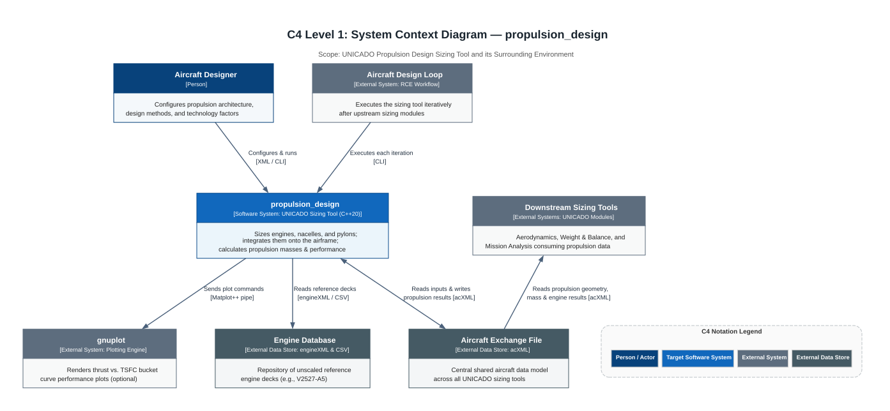
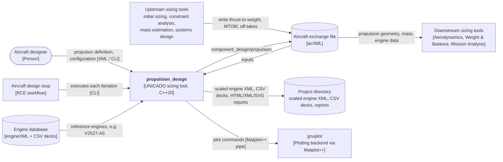

# M1 — Context

## Purpose

`propulsion_design` is a UNICADO **sizing tool** (C++20 executable) in the conceptual aircraft design loop. It provides the scaled engine performance decks and integrates the propulsion systems onto the aircraft airframe. For each propulsor defined in the aircraft exchange file (`acXML`), it:

1. sizes the engine to its share of the required total thrust (`Rubber` scaling strategy),
2. designs the nacelle 3D polygon cross-section geometry,
3. positions the propulsion system on its parent airframe component (`Wing`, `WingBody`, `Fuselage`, or `Empennage`),
4. designs the pylon geometry connecting the nacelle to the parent airframe surface,
5. estimates component point masses, centres of gravity (CG), and inertia tensors.

The results are written back to the aircraft exchange file (`acXML`), project engine deck directory, and HTML/XML/SVG reports for downstream UNICADO tools. *(Documented / Verified)*

## C4 Level 1 — System Context Diagram

*(For the C4 Level 2 Container boundary view showing the internal/external file data stores, see [M4 — Interfaces](../M4-interfaces/c4_level2_container_view.svg)).*

## External actors and systems

| Element | Type | Interaction | Source |
|---|---|---|---|
| Aircraft designer | Person | Defines the propulsors (architecture, parent component, position, thrust share) in the `acXML` and selects design methods and technology factors in `propulsion_design_conf.xml` | Documented |
| Aircraft design loop | External System (`RCE workflow`) | Executes the sizing tool iteratively via CLI after upstream sizing modules | Documented / Verified |
| Upstream sizing tools | External Systems (`UNICADO modules`) | Write the thrust-to-weight ratio (initial sizing first, then constraint analysis), MTOM, airframe geometry, and system off-takes into `acXML` | Documented |
| Aircraft exchange file (`acXML`) | External Data Store | Central shared aircraft data model across all UNICADO sizing tools; main input and output interface accessed via `aixml` and `io::AircraftXML` | Documented / Verified |
| Engine database | External Data Store (`engineXML` & CSV) | Repository of unscaled reference engine datasets and performance decks (e.g., `V2527-A5`, `V2527-H2`) | Documented / Verified |
| Engine library (`UnicadoLibs::engine`) | UNICADO Shared Library | Linked C++ library used to parse reference/scaled engine datasets, interpolate decks, and compute `N1` with shaft/bleed off-take penalties | Documented / Verified |
| Geometry & airfoil data (`.dat` files) | External Data Store | Airfoil and polygon cross-section profiles for airframe, nacelles, and pylons read via `aircraftGeometry2` | Verified (Code Recovery) |
| Project directory | Container Data Store | Receives the scaled engine XML, scaled CSV deck files, `propulsion_design_report.html`, `propulsion_design_results.xml`, and SVG plots | Verified (Code Recovery) |
| `gnuplot` (via `Matplot++`) | External System (Plotting Engine) | Invoked via pipe by `Matplot++` when `plotOn` is enabled to render thrust vs. TSFC bucket curve SVG plots | Verified (Code Recovery) |
| Downstream sizing tools | External Systems (`UNICADO modules`) | Aerodynamics, Weight & Balance, and Mission Analysis modules consuming propulsion geometry, mass, and engine results from `acXML` | Documented |

## Scope

**In scope:** engine selection and rubber scaling, nacelle and pylon 3D surface geometry, propulsion system positioning on wing/wing-body/fuselage/empennage, propulsion mass/CG/inertia properties, and HTML/XML/SVG reporting.

**Out of scope:** thermodynamic engine cycle design (reference decks are generated externally, typically with GasTurb) and mission fuel-burn simulation (computed by downstream mission analysis tools using the scaled engine decks). *(Documented)*

## Quality goals

| Priority | Goal | Rationale |
|---|---|---|
| 1 | Correct, traceable sizing and mass results | Downstream aerodynamics, weight & balance, and mission analysis depend directly on them |
| 2 | Extensible to new powertrains, energy carriers, and fidelity levels | Supported via `Propulsion<EnergyCarrier>` templates and `PropulsionStrategy` subclasses (see [M2](../M2-components/README.md) and technical debt notes in [M12](../M12-risks-technical-debt/README.md)) |
| 3 | Standalone CLI or automated RCE workflow execution | Follows the standardized `moduleBasics::Module` 5-phase execution lifecycle (`initialize` → `run` → `update` → `report` → `save`; see [M7](../M7-runtime/README.md)) |
