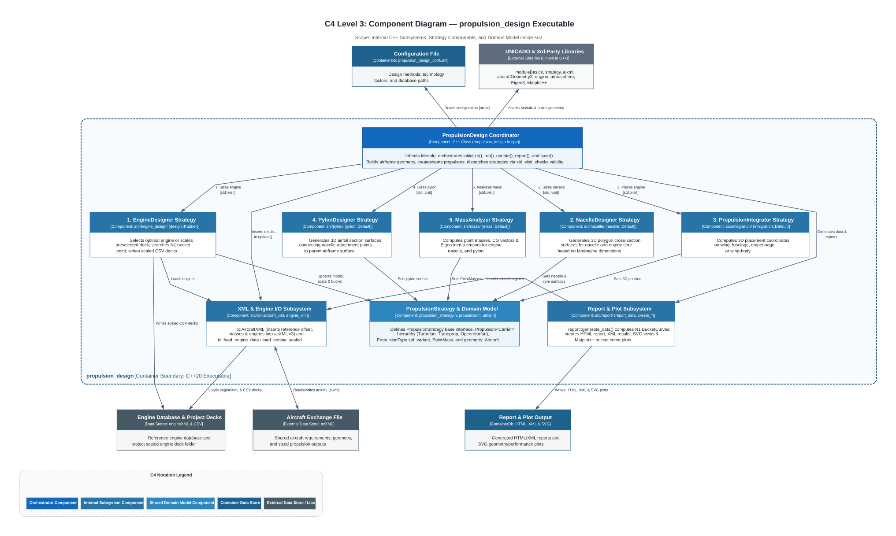
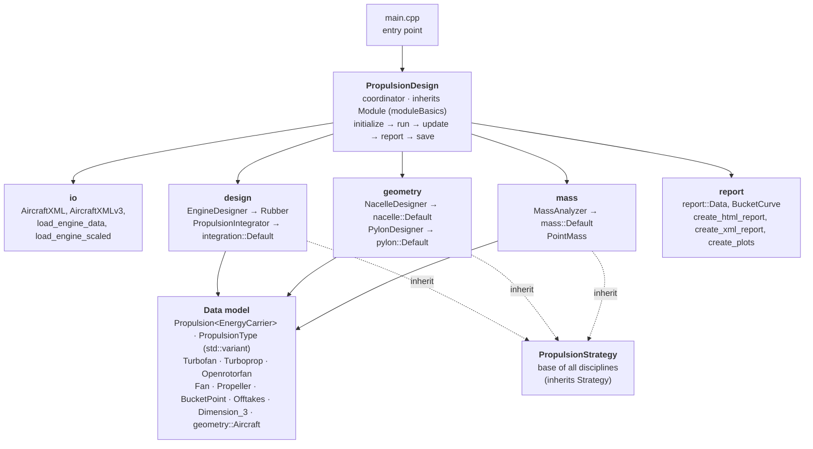

# M2 — Components (building block view)

## C4 Level 3 — Component Diagram



## Level 1 — Whitebox `propulsion_design`



## Level 2 — Classes

```mermaid
classDiagram
    class Module { <<moduleBasics>> }
    class Strategy { <<moduleBasics>> }
    class PropulsionDesign {
      +initialize()
      +run()
      +update()
      +report()
      +save()
      -create_aircraft_geometry()
      -create_propulsors()
      -sort_propulsors()
      -check_validity()
      -select_engine_designer()
      -select_propulsion_integrator()
      -select_nacelle_designer()
      -select_pylon_designer()
      -select_mass_analyzer()
    }
    class PropulsionStrategy {
      +configuration() shared_ptr~node~
      +initialize()
      +update()
      +report()
      +save()
      +operator()(Turbofan~Kerosene~&)
      +operator()(Turbofan~Liquid_Hydrogen~&)
      +operator()(Turboprop~Kerosene~&)
      +operator()(Turboprop~Liquid_Hydrogen~&)
      +operator()(Openrotorfan~Kerosene~&)
    }
    class EngineDesigner {
      +initialize()
      +engine_database()
      +engine_directory()
      +flight_condition()
      +technology_factor(name) double
      +scale_deck_data_values(deck, efficiency)
      +write_deck_value(deck, name)
    }
    class Propulsion~EnergyCarrier~ {
      +id() +model() +scale() +position()
      +nacelle() +pylon() +bucket_point()
      +required_thrust() +offtakes() +pointmass()
      +parent_component()
    }
    Module <|-- PropulsionDesign
    Strategy <|-- PropulsionStrategy
    PropulsionStrategy <|-- EngineDesigner
    PropulsionStrategy <|-- PropulsionIntegrator
    PropulsionStrategy <|-- NacelleDesigner
    PropulsionStrategy <|-- PylonDesigner
    PropulsionStrategy <|-- MassAnalyzer
    EngineDesigner <|-- Rubber
    Propulsion <|-- Turbofan
    Propulsion <|-- Turboprop
    Propulsion <|-- Openrotorfan
    PropulsionDesign --> PropulsionStrategy : selects one per discipline
    PropulsionStrategy ..> Propulsion : operator() mutates via std::visit
```

## Building blocks and C4 Level 4 (Code Level) Diagram Traceability

The internal workings of each component below are modeled in the C4 Level 4 (Code Level) `.drawio` workbooks in [M7 — Runtime](../M7-runtime/README.md):

| Block | Namespace | Main classes / files (`src/`) | Implementations | C4 Level 4 (Code Level) Diagram Tabs |
|---|---|---|---|---|
| Coordinator | — | `PropulsionDesign` (`main.cpp`, `propulsion_design.h/.cpp`) | — | [`PropulsionDesign_MainCPP.drawio`](../M7-runtime/PropulsionDesign_MainCPP.drawio) (`main.cpp`, `propulsion_design.cpp`), [`PropulsionDesign_Initialize.drawio`](../M7-runtime/PropulsionDesign_Initialize.drawio) (`Initialization_PropulsionDesignCPP`) |
| Strategy base | — | `PropulsionStrategy` (`propulsion_strategy.h`) | — | Base interface with virtual `initialize()`, `operator()`, and empty virtual `update()`, `report()`, `save()` |
| Engine designer | `design` | `EngineDesigner`, `Rubber` (`engine_design/engine_design.h/.cpp`, `rubber/rubber_design.h/.cpp`, `turbofan.cpp`, `openrotorfan.cpp`) | `Rubber` (`Empirical` and `PropulsionSystem` planned) | [`PropulsionDesign_Initialize.drawio`](../M7-runtime/PropulsionDesign_Initialize.drawio) (`select_engine_designer()`, `engine_designer->Initialize()`, `EngineDesigner::initialize()`); [`PropulsionDesign_Run.drawio`](../M7-runtime/PropulsionDesign_Run.drawio) (`engine_designer->operator()`) |
| Nacelle designer | `geometry` | `NacelleDesigner`, `nacelle::Default` (`nacelle/nacelle_design.h`, `default/default_nacelle.h/.cpp`, `turbofan.cpp`, `openrotorfan.cpp`) | `nacelle::Default` | [`PropulsionDesign_Initialize.drawio`](../M7-runtime/PropulsionDesign_Initialize.drawio) (`select_nacelle_designer()`, `nacelle_designer->initialize()`); [`PropulsionDesign_Run.drawio`](../M7-runtime/PropulsionDesign_Run.drawio) (`this->nacelle_designer`, `this->get_section_shape()`) |
| Propulsion integrator | `design` | `PropulsionIntegrator`, `integration::Default`, `EngineCount`, `EngineShift` (`integration/propulsion_integration.h`, `default/default_integration.h/.cpp`, `turbofan.cpp`, `openrotorfan.cpp`) | `integration::Default` | [`PropulsionDesign_Initialize.drawio`](../M7-runtime/PropulsionDesign_Initialize.drawio) (`select_propulsion_integrator()`, `propulsion_integrator->initialize()`); [`PropulsionDesign_Run.drawio`](../M7-runtime/PropulsionDesign_Run.drawio) (`this->propulsion_integrator`, `integrate_into_wing/fuselage/empannage/wing_body`, `guess_position()`) |
| Pylon designer | `geometry` | `PylonDesigner`, `pylon::Default` (`pylon/pylon_design.h`, `default/default_pylon.h/.cpp`, `turbofan.cpp`, `openrotorfan.cpp`) | `pylon::Default` | [`PropulsionDesign_Initialize.drawio`](../M7-runtime/PropulsionDesign_Initialize.drawio) (`select_pylon_designer()`, `pylon_designer->initialize()`); [`PropulsionDesign_Run.drawio`](../M7-runtime/PropulsionDesign_Run.drawio) (`this->pylon_designer`, `this->get_attachement_points()`, `this->get_section_profile()`) |
| Mass analyzer | `mass` | `MassAnalyzer`, `mass::Default`, `PointMass` (`mass/mass_analysis.h`, `point_mass.h/.cpp`, `default/default_mass.h`, `turbofan.cpp`, `openrotorfan.cpp`) | `mass::Default` | [`PropulsionDesign_Initialize.drawio`](../M7-runtime/PropulsionDesign_Initialize.drawio) (`select_mass_analyzer()`, `mass_analyzer::intialize()`); [`PropulsionDesign_Run.drawio`](../M7-runtime/PropulsionDesign_Run.drawio) (`this->mass_analyzer`) |
| IO | `io` | `AircraftXML`, `AircraftXMLv3`, `detail::AircraftXMLInterface` (`io/aircraft_xml.h/.cpp`, `io/engine_xml.h/.cpp`) | `AircraftXMLv3`, `io::load_engine_data`, `io::load_engine_scaled` | [`PropulsionDesign_Initialize.drawio`](../M7-runtime/PropulsionDesign_Initialize.drawio) (`io::load_engine_data`, `DeckData::from_csv`, `write_deck_value`); [`PropulsionDesign_Run.drawio`](../M7-runtime/PropulsionDesign_Run.drawio) (`io::load_engine_scaled()`) |
| Report & Plots | `report`, `plot`, `draw` | `report::Data`, `report::BucketCurve` (`report/report_data.h/.cpp`, `create_html_report.cpp`, `create_xml_report.cpp`, `create_plots.cpp`, `file_names.h`) | HTML report, XML report, `Matplot++` & SVG plots | [`PropulsionDesign_Update.drawio`](../M7-runtime/PropulsionDesign_Update.drawio) (`report::generate_data()`, `update_report_data()`); [`PropulsionDesign_Report.drawio`](../M7-runtime/PropulsionDesign_Report.drawio) (`PropulsionDesign_Report()`, `create_report_html()`, `create_plots()`, `create_xml_report()`) |
| Data model | — | `Propulsion<carrier>`, `PropulsionType` (`std::variant`), `Turbofan`, `Turboprop`, `Openrotorfan`, `Fan`, `Propeller`, `BucketPoint`, `FlightCondition`, `Offtakes`, `Dimension_3`, `ParentComponent` (`propulsion.h`, `energy_carrier.h`) | — | [`PropulsionDesign_Initialize.drawio`](../M7-runtime/PropulsionDesign_Initialize.drawio) (`create_propulsors()`, `sort_propulsors()`, `check_validity()`) |
| Aircraft geometry | `geometry` | `geometry::Aircraft` (`aircraft_geometry.h`) | Builds `geom2` wing, fuselage, and empennage surfaces via factories | [`PropulsionDesign_Initialize.drawio`](../M7-runtime/PropulsionDesign_Initialize.drawio) (`create_geometry()`) |
| Utilities | `utility`, `detail` | `utility.h/.cpp` | `create_energy_carrier_map`, `create_engine`, `to_energy_carrier`, `get_parent_component`, `print` | [`PropulsionDesign_Initialize.drawio`](../M7-runtime/PropulsionDesign_Initialize.drawio) (`utility::create_energy_carrier_map`, `utility::create_engine`) |

**Note:** `Openrotorfan<Kerosene>` is implemented across all five discipline strategies (`turbofan.cpp` and `openrotorfan.cpp` in each subfolder) and `utility::create_engine()`, even though it is not described in the user-facing documentation. *(Verified in Code Recovery)*
