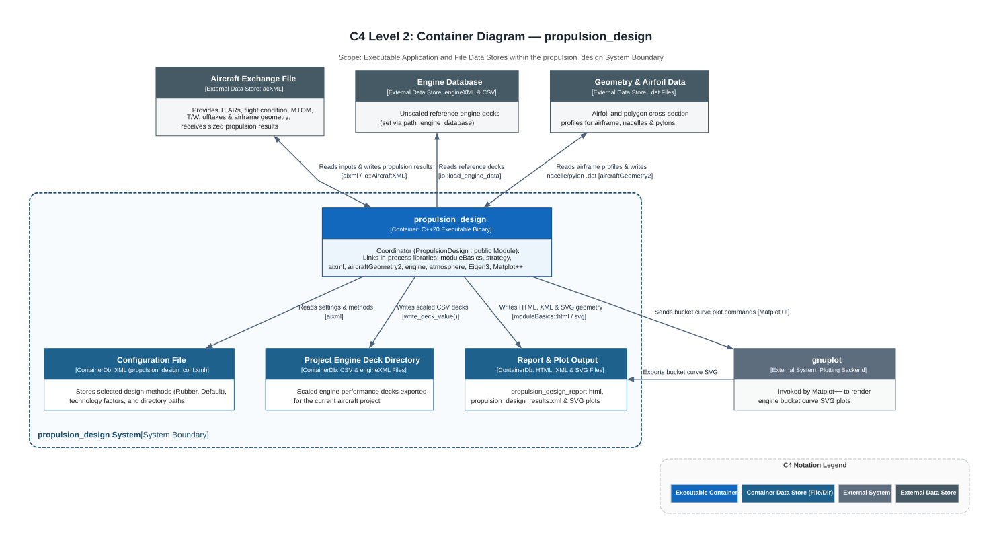
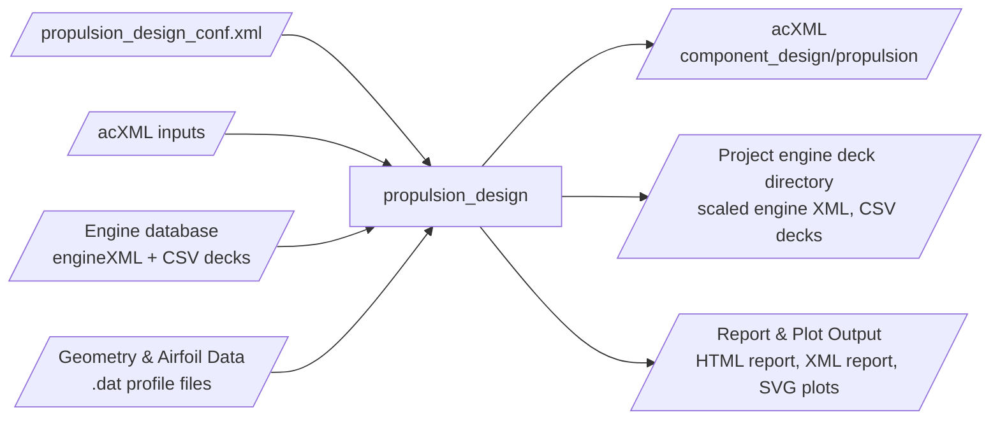

# M4 — Interfaces

## C4 Level 2 — Container & Data Store Overview





## I1 — `acXML` inputs *(Documented / Verified)*

| XML path | Content | If missing / invalid |
|---|---|---|
| `/aircraft_exchange_file/sizing_point/thrust_to_weight` | Design thrust-to-weight ratio (initial sizing first, then constraint analysis) | Required (`<= 0` throws `std::runtime_error("No design thrust given")` in `check_validity()`) |
| `/aircraft_exchange_file/analysis/masses_cg_inertia/maximum_takeoff_mass` | Maximum takeoff mass (`MTOM`) | Required (`<= 0` throws `std::runtime_error("No MTOM given")` in `check_validity()`) |
| `/aircraft_exchange_file/component_design/systems/specific/average_bleed_air_demand` | Average bleed air off-take (`bleed_air`) | Optional; logs warning `"Using default values"` in `create_propulsors()` if missing |
| `/aircraft_exchange_file/component_design/systems/specific/average_power_demand` | Average shaft power off-take (`power_demand` / `shaft_power`) | Optional; logs warning `"Using default values"` in `create_propulsors()` if missing |
| `/aircraft_exchange_file/requirements_and_specifications/design_specification/energy_carriers` | Energy carrier nodes: integer `ID` attribute and string `value` (`kerosene`, `liquid_hydrogen`) | Required; unsupported carrier throws `std::runtime_error("Energy carrier is not supported")` in `utility::create_energy_carrier_map()` |
| `/aircraft_exchange_file/requirements_and_specifications/design_specification/propulsion` | Per propulsor (`ID` attribute): `powertrain`, `type`, `position` (`parent_component`, `x`, `y`, `z`), `energy_carrier_ID`, `thrust_share` | Required; total `thrust_share` mismatch (`abs(actual - required) >= 10.0 N`) throws `std::runtime_error("Total thrust share != 1")` |
| Airframe geometry nodes (`wing`, `fuselage`, `empennage`) | Surface paths and positions read in `create_aircraft_geometry()` via `aircraftGeometry2` factories | Optional; catches `std::string` exception, logs `"No aircraft geometry available"`, sets `aircraft_geometry = nullptr` (integrator falls back to `CGAL::ORIGIN`) |
| `general`, `configuration` nodes | Required by `moduleBasics::Module` | Required |

Allowed position values: parent `wing`, `wing_body` (BWB), `fuselage`, `empennage`; `x` `front`/`back` (`rear`); `y` `left`/`right`/`mid`; `z` `over`/`mid`/`under`/`in`. See [M9 — Configuration](../M9-configuration/README.md) for the implemented combinations.

## I2 — `acXML` outputs *(Documented / Verified)*

Written under `/aircraft_exchange_file/component_design/propulsion` via `io::AircraftXMLv3` in `PropulsionDesign::update()` and persisted via `aixml::saveDocument` in `PropulsionDesign::save()`:

| Node | Content |
|---|---|
| Reference offset & total mass properties | Global `reference_offset` (`Point_3`); total propulsion system `PointMass` (mass, CG, inertia tensor) |
| `specific/propulsion (ID)/engine` | Selected/scaled engine model name, global position, scale factor, SLST, `BucketPoint` (thrust, TSFC), component `PointMass` |
| `specific/propulsion (ID)/nacelle` | Origin, normal, 3D polygon cross-section `sections`, profile name, component `PointMass` |
| `specific/propulsion (ID)/pylon` | Position, normal, 3D airfoil `sections` (chord length, geometric twist), profile name, component `PointMass` |

## I3 — Engine database & geometry `.dat` inputs *(Documented / Verified)*

- **Engine database (`path_engine_database`)**:
  - Content per reference engine: an unscaled engine dataset (`<engine_name>/<engine_name>.xml`) loaded via `io::load_engine_data()` and CSV performance decks over altitude, Mach, and $N_1$ parsed via `DeckData::from_csv()`.
  - Reference engines named in docs: `V2527-A5` (kerosene), `V2527-H2` (liquid hydrogen).
  - Design flight condition (`FlightCondition`): read from `propulsion_design_conf.xml` in `get_design_condition()` (`Mach`, `Altitude`, `ISA` offset; default reference FL350, Mach 0.78, ISA).
- **Geometry & airfoil `.dat` files (`getGeometryDir()`)**:
  - Nacelle cross-section polygon shapes (`this->get_section_shape()`) and pylon airfoil contours (`this->get_section_profile()`) read via `geom2::io::read_dat_file`.

## I4 — Project directory outputs *(Documented / Verified)*

See C4 Level 4 (Depth Level 3) I/O diagrams in [`PropulsionDesign_Initialize.drawio`](../M7-runtime/PropulsionDesign_Initialize.drawio), [`PropulsionDesign_Report.drawio`](../M7-runtime/PropulsionDesign_Report.drawio), and [`PropulsionDesign_Save.drawio`](../M7-runtime/PropulsionDesign_Save.drawio):

- **Scaled engine XML and CSV deck files**: Exported to `getEngineDataDir() / <name> / (<name>.csv)` via `EngineDesigner::write_deck_value()`, one set per unique designed engine model (`add_designed_engine()` prevents duplicate exports).
- **HTML report (`propulsion_design_report.html`)**: Generated in `PropulsionDesign::create_html_report()` (`src/report/create_html_report.cpp`) when `get_RuntimeIO()->reportOn` is enabled.
- **XML report (`propulsion_design_results.xml`)**: Generated in `PropulsionDesign::create_xml_report()` (`src/report/create_xml_report.cpp`) when `get_RuntimeIO()->xmlOn` is enabled; deep-copies the `/aircraft_exchange_file/.../propulsion` subtree via `copy_structure_and_end_values()`.
- **SVG plots**: Generated in `PropulsionDesign::create_plots()` (`src/report/create_plots.cpp`) when `get_RuntimeIO()->plotOn` is enabled (`plot::bucket_curve`, `plot::top_overview`, `plot::nacelle_front`, `plot::nacelle_side`).

## I5 — Programmatic API *(Documented / Verified)*

| Class / Function | Interface | C4 Level 4 Diagram Reference |
|---|---|---|
| `PropulsionDesign` | `PropulsionDesign(argc, argv, toolName, toolVersion)`; `PropulsionDesign(toolName, toolVersion, rtConfigXML)`; `initialize()`, `run()`, `update()`, `report()`, `save()` | [`PropulsionDesign_MainCPP.drawio`](../M7-runtime/PropulsionDesign_MainCPP.drawio) |
| `PropulsionStrategy` | `explicit PropulsionStrategy(const std::shared_ptr<node>& configuration)`; `virtual void initialize()`, `update()`, `report()`, `save()`; `virtual void operator()(Turbofan<Kerosene>&)`, `(Turbofan<Liquid_Hydrogen>&)`, `(Turboprop<Kerosene>&)`, `(Turboprop<Liquid_Hydrogen>&)`, `(Openrotorfan<Kerosene>&)` | [`PropulsionDesign_Run.drawio`](../M7-runtime/PropulsionDesign_Run.drawio) |
| `io::AircraftXML` | `explicit AircraftXML(std::shared_ptr<node>)` selects `AircraftXMLv3`; `insert(Point_3)`, `insert(PointMass)`, `insert(Turbofan<c>)`, `insert(Turboprop<c>)`, `insert(Openrotorfan<c>)` | [`PropulsionDesign_MainCPP.drawio`](../M7-runtime/PropulsionDesign_MainCPP.drawio) |
| `io::load_engine_data` / `io::load_engine_scaled` | Loads unscaled `EngineData` or scaled `Engine` from XML/CSV directories | [`PropulsionDesign_Initialize.drawio`](../M7-runtime/PropulsionDesign_Initialize.drawio) (`io::load_engine_data`), [`PropulsionDesign_Run.drawio`](../M7-runtime/PropulsionDesign_Run.drawio) (`io::load_engine_scaled()`) |

## I6 — Command line *(Documented)*

```bash
propulsion_design            # reads propulsion_design_conf.xml via moduleBasics
```

## Error handling *(Verified in Code Recovery)*

Top-level exception handling in `main.cpp` (see [`PropulsionDesign_MainCPP.drawio`](../M7-runtime/PropulsionDesign_MainCPP.drawio), Tab 1 `main.cpp`) wraps `PropulsionDesign` construction and `execute()` in a `try-catch` block catching `std::string`, `std::exception`, and `...`, printing the error to `std::cerr` and returning `EXIT_FAILURE` (`1`) to the CLI / RCE workflow (or `0` on success). Specific validation exceptions thrown by the module include:

| Condition | Behavior / Exception Thrown | Source Location |
|---|---|---|
| Missing or non-positive `thrust_to_weight` (`<= 0`) | Throws `std::runtime_error("No design thrust given")` | `PropulsionDesign::check_validity()` |
| Missing or non-positive `MTOM` (`<= 0`) | Throws `std::runtime_error("No MTOM given")` | `PropulsionDesign::check_validity()` |
| Propulsor thrust shares do not sum to required thrust (`abs(actual - required) >= 10.0 N`) | Throws `std::runtime_error("Total thrust share != 1")` | `PropulsionDesign::check_validity()` |
| Asymmetric lateral engine thrust moment (`abs(total_moment) >= 10.0 Nm`) | Throws `std::runtime_error("Non-symmetrical thrust")` | `PropulsionDesign::check_validity()` |
| Unsupported energy carrier string or missing `energy_carrier_ID` | Throws `std::runtime_error("Energy carrier is not supported")` / `"Energy carrier ID not found"` | `utility::create_energy_carrier_map()`, `utility::create_engine()` |
| Unsupported `powertrain` + `type` combination | Throws `std::runtime_error("Powertrain is not supported")` | `utility::create_engine()` |
| Unsupported strategy method name in `propulsion_design_conf.xml` | Throws `std::runtime_error("<Discipline> method is not supported")` | `PropulsionDesign::select_*()` |
| Reference engine XML file not found in search paths or empty database | Throws `std::runtime_error` (`File not found` / `"No engine found in the database"`) | `io::load_engine_data()`, `Rubber::select_engine()` |
| Deck file extension is not `.csv` | Throws `std::runtime_error("Not a CSV file")` | `DeckData::from_csv()` |
| Unsupported parent component or orientation / engine count in integration | Throws `std::runtime_error("Parent component not supported")` / `"No space on wing"` / `"Engine count not supported"` / `"Empennage-engine collision"` | `integration::Default`, `pylon::Default` |
| Missing airframe geometry in `acXML` | Non-fatal warning `"No aircraft geometry available"`; sets `aircraft_geometry = nullptr` and places engines at `CGAL::ORIGIN` via `guess_position()` | `create_aircraft_geometry()`, `integration::Default::guess_position()` |
| Missing system off-takes in `acXML` | Non-fatal warning `"Using default values"`; initializes default zero `Offtakes` struct | `PropulsionDesign::create_propulsors()` |
