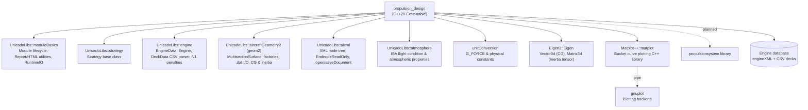

# M5 — Dependencies

## Static Build & Library Dependency Diagrams (`PropulsionDesign_CMake.drawio`)

The static CMake build structure, library linkage, and `#include` header dependencies are modeled in [`PropulsionDesign_CMake.drawio`](PropulsionDesign_CMake.drawio):

| Tab # | Diagram Tab in `PropulsionDesign_CMake.drawio` | Scope & Content |
|---|---|---|
| 1 | `Root CMakeLists` | Top-level `unicado-package/` CMake hierarchy (`aircraft-design/`, `libraries/`, `assessment/`, `utilities/`, `installer/`) |
| 2 | `Aircraft_Design CMakeLists` | `aircraft-design/` package `add_subdirectory` targets (`propulsion_design`, `initial_sizing`, `wing_design`, etc.) and global build tools (`Python/Pipenv`, `Matplot++`, `Gnuplot`, `Googletest`) |
| 3 | `PropulsionDesign CMakeLists` | `aircraft-design/propulsion_design/src/` source subdirectories (`engine_design/`, `integration/`, `nacelle/`, `pylon/`, `mass/`, `io/`, `report/`) compiled into `«Executable» propulsion_design` and privately linked against UNICADO & third-party libraries |
| 4 | `PropulsionDesign Libraries Dependency` | Overview of `#include` dependencies from `propulsion_design/src/` subdirectories to linked UNICADO and third-party libraries |
| 5 | `PropulsionDesign Mass Dependency` | Detailed file-level dependency trace for `propulsion_design/src/mass/` (`mass_analysis.h`, `point_mass.h/.cpp`, `default_mass.h`, `turbofan.cpp`, `openrotorfan.cpp`) against `UnicadoLibs::aircraftGeometry2` and `Eigen3::Eigen` |

*(In addition, every C4 Level 4 Code-Level diagram in [M7 — Runtime](../M7-runtime/README.md) includes an **`Explicit File Dependencies`** block at the bottom tracing exact file-by-file `#include` and library calls).*

## Libraries *(Verified from `CMakeLists.txt` & C4 Code-Level Recovery)*

| Dependency | Kind | Used for | Status | Source |
|---|---|---|---|---|
| `UnicadoLibs::moduleBasics` | UNICADO library | `Module` lifecycle base class (`execute`); `RuntimeIO` directory/flag access; HTML `Report` utilities | Required | Documented / Verified |
| `UnicadoLibs::strategy` | UNICADO library | `Strategy` base class inherited by `PropulsionStrategy` | Required | Verified (Code Recovery) |
| `UnicadoLibs::engine` | UNICADO library | `EngineData`, `Engine`, `DeckData::from_csv` parser, `calculate_N1_with_penalties()`, deck interpolation & scaling | Required | Documented / Verified |
| `UnicadoLibs::aircraftGeometry2` (`geom2`) | UNICADO library | Airframe, nacelle, and pylon 3D `MultisectionSurface` builders, `.dat` airfoil I/O, `geom2::measure::centroid()` (CG), `geom2::measure::inertia()`, `geom2::transform::to_parent/to_local` | Required | Documented / Verified |
| `UnicadoLibs::aixml` | UNICADO library | XML parsing (`aixml::node`, `EndnodeReadOnly`, `openDocument`, `saveDocument`, `closeDocument`) for `acXML`, `propulsion_design_conf.xml`, and `engineXML` | Required | Verified (Code Recovery) |
| `UnicadoLibs::atmosphere` | UNICADO library | Atmospheric state initialization in `get_design_condition()` and `calculate_N1_with_penalties()` | Required | Verified (Code Recovery) |
| `unitConversion` | UNICADO header library | Physical constants (`G_FORCE` in `create_propulsors()` and `check_validity()`) | Required | Verified (Code Recovery) |
| `Eigen3::Eigen` | Third-party C++ library | `Eigen::Vector3d` (CG coordinates) and `Eigen::Matrix3d` (inertia tensors) in `PointMass` and `MassAnalyzer` | Required | Verified (Code Recovery) |
| `Matplot++::matplot` | Third-party C++ library | Generating TSFC vs. thrust bucket curve SVG plots in `create_plots.cpp` | Required (fetched via CMake `FetchContent`) | Verified (Code Recovery) |
| `propulsionsystem` | UNICADO library | Future engine method `"PropulsionSystem"` | Planned, not used | Documented |
| C++20 standard library | Toolchain | `std::variant`, `std::visit`, `std::filesystem`, `std::ranges`, `std::format`, `<algorithm>`, `<memory>` | Required | Verified (Code Recovery) |
| CMake | Build system | Multi-directory CMake build configuration | Required | Verified (Code Recovery) |

## Runtime tools

| Tool | When | Setting / Invocation |
|---|---|---|
| `gnuplot` | Rendering engine bucket curve SVG plots | Invoked via pipe by `Matplot++` when `get_RuntimeIO()->plotOn` (`plot_output`) is enabled |

## Data dependencies

| Data | Provided by | Notes |
|---|---|---|
| Thrust-to-weight ratio (`T/W`) | Initial sizing, then constraint analysis | Multiplied by `MTOM * G_FORCE` to compute total required thrust |
| `MTOM` | Mass estimation (`weight_and_balance_analysis`) | Changes each sizing loop iteration, triggering engine re-scaling |
| Off-takes (`bleed_air`, `shaft_power`) | Systems design (`systems_design`) | Default zero off-takes are used with a warning if missing |
| Airframe geometry (`wing`, `fuselage`, `empennage`) | Wing, fuselage, and empennage design modules | Used for 3D engine integration and pylon attachment points |
| Reference engines | Engine database (`path_engine_database`) | Created outside UNICADO, typically with GasTurb |

## Reverse dependencies

Downstream UNICADO modules reading `/aircraft_exchange_file/component_design/propulsion` include `weight_and_balance_analysis` (masses, CG, inertia), `aerodynamic_analysis` (nacelle and pylon wetted surfaces), `systems_design`, and `mission_analysis` (scaled engine decks and bucket points). Any schema change to `I2` in [M4 — Interfaces](../M4-interfaces/README.md) affects these consumers.

## Version and compatibility notes

- The `io` subsystem maintains compatibility with `acXML` schema versions via the adapter `io::AircraftXML`, which selects the matching `io::detail::AircraftXMLInterface` implementation (`AircraftXMLv3`). *(Documented / Verified)*
- The stakeholder survey identified frequent build and runtime issues from unpinned library, Python, and CMake versions across developer environments (see [M12 — Risks and technical debt](../M12-risks-technical-debt/README.md), Requirement R6).
