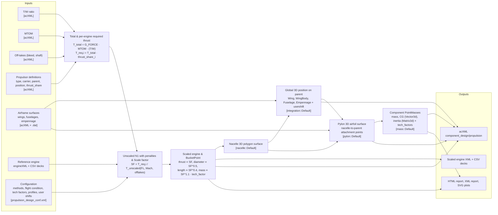

# M6 — Data flow

## High-Level Data Transformation Flow

*Verified in `create_propulsors()` ([`PropulsionDesign_Initialize.drawio`](../M7-runtime/PropulsionDesign_Initialize.drawio), Tab 3):*
$$\text{total\_thrust\_required} = G\_FORCE \times \text{MTOM} \times (T/W)$$
$$\text{design\_thrust}_i = \text{total\_thrust\_required} \times \text{thrust\_share}_i, \qquad \text{engine\_offtakes}_i = \text{total\_offtakes\_required} \times \text{thrust\_share}_i$$

## Rubber Engine Scaling Rules *(Documented / Verified)*

Scaled value = reference value $\times \text{SF}^X$:

| Quantity | Exponent $X$ | Implementation Notes |
|---|---|---|
| Thrust, fuel flow, mass flow, max bleed, max shaft off-take, LTO fuel flow | `1.0` | Deck CSV values scaled in `EngineDesigner::scale_deck_data_values()` with efficiency factor `1 + (1 - efficiency_factor)` |
| Nacelle / fan diameter | `0.5` | Raymer empirical scaling in `Rubber::operator()` (`engine.set_dimension()`, `engine.set_fan()`) |
| Engine length | `0.4` | Updated to `0.4` in v3.0.0 (`Rubber::operator()`) |
| Engine dry mass | `1.1` | Multiplied by `technology_factor("engine_mass")` in `Rubber::operator()` and `mass::Default` |
| LTO emissions | `0.0` | Unchanged |

TSFC remains constant (modified only by the user-configured `engine_efficiency` technology factor).

## Data Lifecycle and C4 Level 4 (Code Level) Traceability in One Sizing Iteration

Each data transformation step is modeled at C4 Level 4 (Depth Levels 1–4) in the `.drawio` workbooks located in [M7 — Runtime](../M7-runtime/README.md):

| Step | Phase | Data Created / Transformed | Created By | Persisted Where | C4 Level 4 (Code Level) Diagram Tabs |
|---|---|---|---|---|---|
| 1 | `initialize()` | `aircraft_geometry` (`wings`, `fuselages`, `empennages` in global coordinates) | `create_aircraft_geometry()` | Memory (`std::shared_ptr<geometry::Aircraft>`) | [`PropulsionDesign_Initialize.drawio`](../M7-runtime/PropulsionDesign_Initialize.drawio): Tab 2 `create_geometry()` |
| 2 | `initialize()` | `EnergyCarriersMap`, sorted `this->engines` (`std::vector<PropulsionType>`), initial thrust & moment validity check | `create_propulsors()`, `sort_propulsors()`, `check_validity()` | Memory (`this->engines`) | [`PropulsionDesign_Initialize.drawio`](../M7-runtime/PropulsionDesign_Initialize.drawio): Tabs 3–7 (`create_propulsors()`, `utility::create_energy_carrier_map`, `utility::create_engine`, `sort_propulsors()`, `check_validity()`) |
| 3 | `initialize()` | Preselected engine map, efficiency-adjusted CSV decks | `Rubber::initialize()`, `EngineDesigner::scale_deck_data_values()`, `write_deck_value()` | Project engine deck directory (`getEngineDataDir()`) | [`PropulsionDesign_Initialize.drawio`](../M7-runtime/PropulsionDesign_Initialize.drawio): Tabs 13–18 |
| 4 | `run()` | Selected engine model, unscaled $N_1$ with offtake penalties, scale factor (`SF`), scaled dimensions, `BucketPoint` | `Rubber::operator()`, `select_engine()`, `calculate_N1_with_penalties()`, `calculate_bucket_point()` | Memory (`Propulsion` variant) & Project engine directory | [`PropulsionDesign_Run.drawio`](../M7-runtime/PropulsionDesign_Run.drawio): Tabs 2–7 |
| 5 | `run()` | Nacelle and engine core 3D polygon `MultisectionSurface` | `nacelle::Default::operator()`, `get_section_shape()` | Memory (`Propulsion` variant) | [`PropulsionDesign_Run.drawio`](../M7-runtime/PropulsionDesign_Run.drawio): Tabs 8–9 |
| 6 | `run()` | Global 3D engine position on `Wing`, `WingBody`, `Fuselage`, or `Empennage` (with `usershift_x/y/z`) | `integration::Default::operator()`, `integrate_into_*()`, `guess_position()` | Memory (`Propulsion` variant) | [`PropulsionDesign_Run.drawio`](../M7-runtime/PropulsionDesign_Run.drawio): Tabs 10–15 |
| 7 | `run()` | Pylon 3D airfoil `MultisectionSurface` from nacelle to parent attachment points | `pylon::Default::operator()`, `get_attachement_points()`, `get_section_profile()` | Memory (`Propulsion` variant) | [`PropulsionDesign_Run.drawio`](../M7-runtime/PropulsionDesign_Run.drawio): Tabs 16–18 |
| 8 | `run()` | Engine, nacelle, and pylon `PointMass` (`mass`, `CG` vector, `inertia` tensor) + post-run `check_validity()` | `mass::Default::operator()`, `check_validity()` | Memory (`Propulsion` variant) | [`PropulsionDesign_Run.drawio`](../M7-runtime/PropulsionDesign_Run.drawio): Tab 19 `this->mass_analyzer` & Tab 1 `PropulsionDesign_Run()` |
| 9 | `update()` | Updated `acXML` propulsion subtree + `report::Data` (`BucketCurve` with and without offtakes) | `io::AircraftXML::insert()`, `report::generate_data()`, `update_report_data()` | Memory (`aircraft_xml`, `report::Data`) | [`PropulsionDesign_Update.drawio`](../M7-runtime/PropulsionDesign_Update.drawio): Tabs 1–3 |
| 10 | `report()` | `propulsion_design_report.html`, `propulsion_design_results.xml`, SVG bucket curve & geometry plots | `create_html_report()`, `create_xml_report()`, `create_plots()` | Report & plot output directories | [`PropulsionDesign_Report.drawio`](../M7-runtime/PropulsionDesign_Report.drawio): Tabs 1–4 |
| 11 | `save()` | Persisted `acXML` file on disk | `PropulsionDesign::save()`, `aixml::saveDocument()` | Aircraft exchange file (`acXML`) | [`PropulsionDesign_Save.drawio`](../M7-runtime/PropulsionDesign_Save.drawio): Tab 1 |

## Data rules

- Engine performance decks are **only** interpolated and evaluated with off-take penalties through the linked `UnicadoLibs::engine` library (`Engine::calculate_N1_with_penalties`). *(Documented / Verified)*
- Propulsors are partitioned before execution by `sort_propulsors()` (placing `Lateral::Left` engines before `Lateral::Right` and ordering inner before outer wing engines) and processed sequentially in `run()`. *(Verified in Code Recovery)*
- Unique scaled engine models are exported once per run (`EngineDesigner::add_designed_engine` tracks designed models in an `std::unordered_set`). *(Documented / Verified)*
