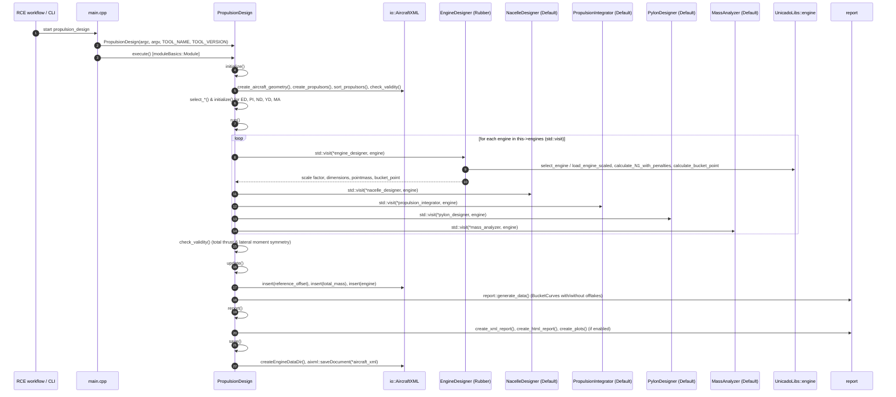

# M7 — Runtime

## Scenario R1 — One Run in the Aircraft Design Loop

*Verified in `PropulsionDesign::run()` ([`PropulsionDesign_Run.drawio`](PropulsionDesign_Run.drawio), Tab 1):*
1. Each propulsor in `this->engines` is stored as a `std::variant` (`PropulsionType`) and dispatched to each strategy via `std::visit(*this-><strategy>, engine)`.
2. The exact execution order inside the `run()` loop is:
   **`engine_designer`** → **`nacelle_designer`** → **`propulsion_integrator`** → **`pylon_designer`** → **`mass_analyzer`** (because `pylon_designer` requires the global engine position computed by `propulsion_integrator` to determine the nacelle-to-airframe attachment points).
3. After the per-engine loop finishes, `PropulsionDesign::run()` invokes `this->check_validity()` a second time to verify that total installed thrust matches required thrust (`< 10 N` tolerance) and lateral thrust moment is balanced (`< 10 Nm` tolerance).

---

## C4 Level 4 (Code Level) — 5-Tier Diagram Hierarchy (`Depth Levels 0–4`)

All 6 C4 Level 4 (Code Level) `.drawio` workbooks are stored in this folder and structured according to the 5-tier progressive granularity taxonomy:

- **Depth Level 0**: Top-level binary entry point (`main.cpp`) and 5-phase lifecycle orchestration (`propulsion_design.cpp`).
- **Depth Level 1**: High-level workflow for each of the 5 lifecycle phases (`initialize()`, `run()`, `update()`, `report()`, `save()`).
- **Depth Level 2**: Execution operators (`initialize()` and `operator()`) for the 5 core discipline strategies (`EngineDesigner`, `NacelleDesigner`, `PropulsionIntegrator`, `PylonDesigner`, `MassAnalyzer`) and coordinator subroutines.
- **Depth Level 3**: Standalone diagrams for specific geometric, mathematical, or file I/O helper routines.
- **Depth Level 4**: Deep subroutines embedded directly as **"Expanded Views"** inside Depth Level 3 diagrams to prevent visual clutter.

### 1. [`PropulsionDesign_MainCPP.drawio`](PropulsionDesign_MainCPP.drawio) *(Depth Level 0)*

| Tab # | Tab Name | Depth Level | Description |
|---|---|---|---|
| 1 | `main.cpp` | Level 0 | System boot, `PropulsionDesign` construction, `Module::execute()` call, and top-level `try-catch` exception handling (`std::string`, `std::exception`, unknown errors) |
| 2 | `propulsion_design.cpp` | Level 0 | High-level 5-phase lifecycle pipeline (`initialize()` → `run()` → `update()` → `report()` → `save()`) and explicit file dependencies |

### 2. [`PropulsionDesign_Initialize.drawio`](PropulsionDesign_Initialize.drawio) *(Phase 1: `initialize()` — Depth Levels 1–3)*

| Tab # | Tab Name | Depth Level | Description |
|---|---|---|---|
| 1 | `Initialization_PropulsionDesignCPP` | Level 1 | `PropulsionDesign::initialize()` master pipeline |
| 2 | `create_geometry()` | Level 2 | `create_aircraft_geometry()` building wing, fuselage, and empennage `geom2` surfaces |
| 3 | `create_propulsors()` | Level 2 | Reading `MTOM`, `T/W`, `offtakes`, and instantiating propulsors |
| 4 | `utility::create_energy_carrier_map` | Level 3 | Mapping XML `energy_carrier` IDs to `EnergyCarrier` enums (`Kerosene`, `Liquid_Hydrogen`) |
| 5 | `utility::create_engine` | Level 3 | Constructing `Turbofan`, `Turboprop`, or `Openrotorfan` `std::variant` instances |
| 6 | `sort_propulsors()` | Level 2 | Partitioning engines by lateral (`Left` first) and spanwise position |
| 7 | `check_validity()` | Level 2 | Verifying `T/W > 0`, `MTOM > 0`, total thrust share, and lateral moment symmetry |
| 8 | `select_engine_designer()` | Level 2 | Reading flight condition (`get_design_condition()`) and instantiating `design::Rubber` |
| 9 | `select_propulsion_integrator()` | Level 2 | Counting engines per parent surface and instantiating `integration::Default` |
| 10 | `select_nacelle_designer()` | Level 2 | Instantiating `nacelle::Default` with geometry directory |
| 11 | `select_pylon_designer()` | Level 2 | Instantiating `pylon::Default` with aircraft geometry and geometry directory |
| 12 | `select_mass_analyzer()` | Level 2 | Instantiating `mass::Default` |
| 13 | `engine_designer->Initialize()` | Level 2 | `Rubber::initialize()`: preselected engine map and efficiency factor validation |
| 14 | `EngineDesigner::initialize()` | Level 3 | Base class reading `engine_mass`, `engine_efficiency`, and `path_engine_database` |
| 15 | `io::load_engine_data` | Level 3 | Searching engine database paths and loading unscaled `EngineData` XML |
| 16 | `DeckData::from_csv` | Level 3 | Parsing engine performance CSV decks |
| 17 | `EngineDesigner::scale_deck_data_values` | Level 3 | Scaling 3D deck arrays by `1 + (1 - efficiency_factor)` |
| 18 | `EngineDesigner::write_deck_value` | Level 3 | Exporting scaled CSV deck files to the project engine directory |
| 19 | `propulsion_integrator->initialize()` | Level 2 | Base class empty virtual override note (`void initialize() override {}`) |
| 20 | `nacelle_designer->initialize()` | Level 2 | Reading per-propulsor and default `nacelle/profile/value` shape names |
| 21 | `pylon_designer->initialize()` | Level 2 | Reading per-propulsor and default `pylon/profile/value` airfoil names |
| 22 | `mass_analyzer::intialize()` | Level 2 | Reading `engine_mass`, `nacelle_mass`, and `pylon_mass` technology factors |

### 3. [`PropulsionDesign_Run.drawio`](PropulsionDesign_Run.drawio) *(Phase 2: `run()` — Depth Levels 1–4)*

| Tab # | Tab Name | Depth Level | Description |
|---|---|---|---|
| 1 | `PropulsionDesign_Run()` | Level 1 | `PropulsionDesign::run()` per-engine dispatch loop and post-loop `check_validity()` |
| 2 | `engine_designer->operator()` | Level 2 | `Rubber::operator()` unified engine sizing workflow |
| 3 | `this->select_engine()` | Level 3 + 4 | Scanning engine database for minimum SLST deviation (includes Level 4 Expanded Views for `io::load_engine_data(lhs/rhs)`) |
| 4 | `io::load_engine_data()` | Level 3 | Unscaled engine XML lookup and parsing |
| 5 | `io::load_engine_scaled()` | Level 3 + 4 | Scaled engine loading (includes Level 4 Expanded View for `Engine{...}` constructor) |
| 6 | `engine_unscaled.calculate_N1_with_penalties()` | Level 3 + 4 | $N_1$ operating point iteration with shaft/bleed penalties (includes 6 Level 4 Expanded Views: `set_correction_factors`, `set_lower_N1_limit`, `set_upper_N1_limit`, `calculate_offtake_correction`, `set_N1_to_rating`, `check_offtake_boundaries`) |
| 7 | `this->calculate_bucket_point()` | Level 3 | Bucket point thrust and TSFC search between idle and takeoff $N_1$ |
| 8 | `this->nacelle_designer` | Level 2 | `nacelle::Default::operator()` dispatching `turbofan_method()` / `openrotor_method()` |
| 9 | `this->get_section_shape()` | Level 3 | Building normalized nacelle cross-section polygon via `geom2::build::ellipse` or `.dat` file |
| 10 | `this->propulsion_integrator` | Level 2 | `integration::Default::operator()` parent component check and dispatch |
| 11 | `this->integrate_into_wing()` | Level 3 + 4 | Wing engine placement for 2 or 4 engines (includes 4 Level 4 Expanded Views: `select_wing`, `select_fuselage`, `calculate_span_position`, `calculate_user_shift`) |
| 12 | `this->integration_into_fuselage()` | Level 3 + 4 | Rear fuselage engine placement (includes 2 Level 4 Expanded Views: `select_fuselage`, `calculate_user_shift`) |
| 13 | `this->integrate_to_empannage()` | Level 3 + 4 | Vertical tail engine placement (includes 2 Level 4 Expanded Views: `select_fuselage`, `select_vertical_tail`) |
| 14 | `this->integrate_into_wing_body()` | Level 3 + 4 | Over-wing-body (BWB) placement with empennage collision checks (includes Level 4 Expanded View: `select_wing`) |
| 15 | `this->guess_position()` | Level 3 | Fallback placement at `CGAL::ORIGIN` when aircraft geometry is unavailable |
| 16 | `this->pylon_designer` | Level 2 | `pylon::Default::operator()` workflow |
| 17 | `this->get_attachement_points()` | Level 3 + 4 | Computing nacelle-to-parent attachment coordinates (includes 3 Level 4 Expanded Views: `get_wing_attachment_points`, `get_wing_body_attachment_points`, `get_fuselage_attachment_points`) |
| 18 | `this->get_section_profile()` | Level 3 | Loading pylon airfoil contour `.dat` file via `geom2::io::read_dat_file` |
| 19 | `this->mass_analyzer` | Level 2 + 4 | `mass::Default::operator()` computing Engine, Nacelle, and Pylon `PointMass` objects (with Expanded Views for `turbofan_method` and `openrotor_method`) |

### 4. [`PropulsionDesign_Update.drawio`](PropulsionDesign_Update.drawio) *(Phase 3: `update()` — Depth Levels 1–4)*

| Tab # | Tab Name | Depth Level | Description |
|---|---|---|---|
| 1 | `PropulsionDesign_Update()` | Level 1 / 2 | High-level report data generation workflow invoked during `PropulsionDesign::update()` |
| 2 | `report::generate_data()` | Level 3 + 4 | Iterating over propulsors to compute `report::Data` (includes Level 4 Expanded View: `update_report_data()`) |
| 3 | `update_report_data()` | Level 3 | Standalone detailed view of `update_report_data()` computing `BucketCurve` with and without offtakes |

### 5. [`PropulsionDesign_Report.drawio`](PropulsionDesign_Report.drawio) *(Phase 4: `report()` — Depth Levels 1 & 3)*

| Tab # | Tab Name | Depth Level | Description |
|---|---|---|---|
| 1 | `PropulsionDesign_Report()` | Level 1 | `PropulsionDesign::report()` pipeline checking `xmlOn`, `reportOn`, and `plotOn` flags (plus empty base-class `.report()` virtual override note) |
| 2 | `this->create_report_html()` | Level 3 | Generating `propulsion_design_report.html` summary tables, engine data, and embedded SVG plot tags |
| 3 | `this->create_plots()` | Level 3 | Generating SVG plots (`plot::bucket_curve` via `Matplot++`, `plot::top_overview`, `plot::nacelle_front`, `plot::nacelle_side`) |
| 4 | `this->create_xml_report()` | Level 3 | Exporting `propulsion_design_results.xml` by deep-copying the sized propulsion XML subtree |

### 6. [`PropulsionDesign_Save.drawio`](PropulsionDesign_Save.drawio) *(Phase 5: `save()` — Depth Level 1)*

| Tab # | Tab Name | Depth Level | Description |
|---|---|---|---|
| 1 | `Page-1` | Level 1 | `PropulsionDesign::save()` pipeline: creating engine data directory if missing, saving `*this->aircraft_xml` via `aixml::saveDocument`, and documenting empty base-class `.save()` overrides |

---

## Additional Runtime Scenarios

- **Scenario R2 — Duplicate Engine Models**: With multiple identical engines (e.g., $2 \times \text{V2527-A5}$ under the wing), `EngineDesigner::add_designed_engine()` returns `false` after the first engine, avoiding redundant CSV deck exports while still positioning and weighing each propulsor independently. *(Documented / Verified)*
- **Scenario R3 — Run Without Plot Generation**: When `get_RuntimeIO()->plotOn` is `false`, `PropulsionDesign::report()` skips `this->create_plots()` and generates only the HTML/XML reports. *(Verified)*
- **Scenario R4 — Run Without Airframe Geometry (Dummy / Stub Run)**: When airframe geometry cannot be built in `create_aircraft_geometry()`, a warning `"No aircraft geometry available"` is logged, `aircraft_geometry` is set to `nullptr`, and `integration::Default` calls `guess_position()` to place engines at `CGAL::ORIGIN`. *(Verified)*

## Execution Properties

| Property | Value |
|---|---|
| Process model | Single process, single-threaded C++20 binary *(Verified)* |
| Invocation | Command line (`propulsion_design`); orchestrated iteratively via RCE in UNICADO design loops |
| Re-entrancy | Runs once per sizing iteration, updating `/aircraft_exchange_file/component_design/propulsion` in `acXML` |
